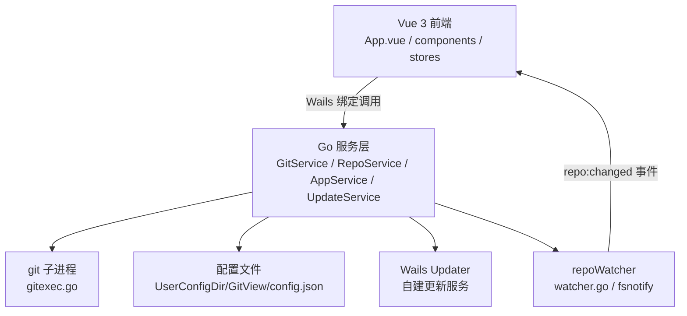

# Git View

> **本项目（Git View）的代码与文档全部由 AI 编写。** 从架构设计、Go 后端、Vue 前端到构建脚本，均由 AI 生成，人工仅做需求描述与验收。

Git View 是一个基于 **Wails v3** 构建的现代化 Git 桌面客户端：Go 负责 Git 操作与仓库监听，Vue 3 负责界面渲染，二者通过 Wails 自动生成的绑定直接调用。它面向本地工作流的日常使用——多仓库管理、提交历史浏览、文件暂存/提交、分支与标签、合并/变基/拣选、暂存区（stash）、远端操作、内置终端，以及应用自更新。

---

## 一、简介

- **定位**：轻量、响应式的本地 Git GUI，单窗口多仓库。
- **技术形态**：Wails v3 桌面应用（Go 后端 + Web 前端，同进程内通信，无独立 HTTP 服务）。
- **交互风格**：macOS 原生半透明窗口、隐藏式标题栏、圆角与毛玻璃背景；前端为 Vue 3 + TypeScript + Vite。
- **刷新模型**：**事件驱动**，无后台轮询。后端用 `fsnotify` 监听活动仓库的 `.git`，变化时通过 `repo:changed` 事件推给前端（详见 [`docs/fs-watch.md`](docs/fs-watch.md)）。
- **自更新**：集成 Wails v3 内置 updater，从自建更新服务检查/下载/安装新版本。
- **作者**：xiangzongliang
- **版本**：见 `build/config.yml` 的 `info.version` 与 `appservice.go` 的 `appVersion`。

---

## 二、架构

### 2.1 总体分层



### 2.2 后端（Go，根目录包 `main`）

| 文件                | 职责                                                                                                                                                     |
| ------------------- | -------------------------------------------------------------------------------------------------------------------------------------------------------- |
| `main.go`           | 应用入口：创建 Wails 应用、注册服务、创建窗口、初始化更新器                                                                                              |
| `gitservice.go`     | 核心 Git 服务：状态、日志、提交、分支/标签、合并/变基/拣选/回退、远端、stash、内置终端命令、分步命令执行（`RunGitStep`，供合并向导等流程展示命令与输出） |
| `reposervice.go`    | 仓库管理：注册/移除仓库、分组与排序持久化、克隆、初始化、在文件管理器中打开                                                                              |
| `appservice.go`     | 应用信息：版本、作者、本机 git 版本                                                                                                                      |
| `updaterservice.go` | 自更新：检查/下载安装/重启，更新源集中配置                                                                                                               |
| `watcher.go`        | 基于 `fsnotify` 的仓库变化监听与去抖/节流/风暴保护                                                                                                       |
| `gitexec.go`        | git 子进程封装：超时、环境隔离、只读命令 `GIT_OPTIONAL_LOCKS=0`、自激刷新屏蔽                                                                            |
| `debuglog.go`       | 有界环形缓冲区，记录执行过的命令供内置调试窗口查看                                                                                                       |
| `types.go`          | 前后端共享的数据结构（`RepoStatus`、`Commit`、`BranchInfo` 等）                                                                                          |

**关键设计点**

- **服务即绑定**：四个 `*Service` 结构体的**导出方法**会被 `wails3 generate bindings` 自动生成为前端可调用的 TypeScript 绑定；小写方法（如 `UpdateService.configure`）不会被暴露。
- **git 执行安全**：所有命令通过 `gitexec.go` 运行，强制 `LC_ALL=C`、禁用分页/编辑器/交互式凭据提示，本地命令 60s 超时、网络命令 10min 超时。
- **防自激刷新**：只读命令走 `runGitRO`（`GIT_OPTIONAL_LOCKS=0`，避免 `git status` 重写 `.git/index`）；命令执行期间及其后 800ms 的监听事件被忽略（`ownGitActivity`）。
- **监听范围刻意很小**：只监听 `.git` 及其下固定小集合（refs 常用目录、HEAD、index、中断标记等，上限 48 个路径），避免 macOS(kqueue)/Linux(inotify) 句柄耗尽。
- **更新源集中配置**：`updaterservice.go` 顶部常量定义更新域名/清单路径/产物关键字，可用环境变量（`GITVIEW_UPDATE_BASE_URL` 等）或 `-ldflags` 覆盖。

### 2.3 前端（Vue 3 + TypeScript，`frontend/`）

- **入口**：`frontend/index.html` → `src/main.ts`（创建 Vue 应用 + Pinia）→ `src/App.vue`。
- **状态管理**（Pinia，`src/stores/`）：
    - `repo.ts`：当前仓库的状态、历史、文件、diff 等（核心 store）
    - `repos.ts`：多仓库列表、分组、激活仓库
    - `ui.ts`：界面状态（侧栏宽度、视图、busy、弹窗、终端开关等）
    - `settings.ts`：用户设置（主题等）
- **API 层**：`src/api/index.ts` 统一从 `bindings/gitview`（自动生成）导入后端服务与类型，并封装目录选择、复制、错误信息提取。
- **组件目录**（`src/components/`）：
    - `layout/`：标题栏、工具栏、状态栏、内置终端面板
    - `sidebar/`：仓库列表、分组、引用导航（分支/标签/stash）
    - `history/`：提交历史、提交行、提交详情
    - `status/`：工作区变更列表与详情
    - `dialogs/`：克隆、分支、合并、当前分支合并到（分步向导）、拉取、推送、重置、stash、标签等对话框
    - `settings/`：设置面板（含「关于」页，对接自更新）
    - `common/`：Diff 查看器、Toast、右键菜单、调试面板等
    - `ui/`：通用基础组件（按钮、复选框、图标、弹窗、下拉、提示等）
- **工具函数**（`src/utils/`）：`ansi.ts`（终端 ANSI 解析）、`diff.ts`（diff 渲染）、`graph.ts`（提交图谱）、`format.ts`、`groupIcons.ts`。
- **样式**：全局主题在 `frontend/public/style.css`，以 CSS 变量/token 形式按亮/暗主题定义。

### 2.4 前后端通信

- **前端 → 后端**：调用生成的绑定（`GitService.*`、`RepoService.*`、`AppService.*`、`UpdateService.*`）。
- **后端 → 前端**：通过 `application.Event.Emit` 推送 `repo:changed` 事件，前端在 `App.vue` 中按 `kind`（`status` / `refs` / `all`）刷新对应数据；窗口重新可见时补一次 `all` 刷新。

---

## 三、技术规范

### 3.1 技术栈

| 层       | 技术                                     | 版本/说明                                |
| -------- | ---------------------------------------- | ---------------------------------------- |
| 应用框架 | Wails v3                                 | `v3.0.0-beta.6`                          |
| 后端语言 | Go                                       | `1.25.0`（`go.mod`）                     |
| 文件监听 | `github.com/fsnotify/fsnotify`           | `v1.7.0`                                 |
| 前端框架 | Vue 3                                    | `^3.5.43`                                |
| 语言     | TypeScript                               | `^4.9.3`（类型检查用 `vue-tsc`）         |
| 构建工具 | Vite                                     | `^8.0.5`                                 |
| 状态管理 | Pinia                                    | `^4.0.3`                                 |
| 路由     | vue-router                               | `^5.3.1`                                 |
| 图标     | `@lucide/vue`                            | `^1.47.0`                                |
| 时间处理 | dayjs                                    | `^1.11.23`                               |
| 代码高亮 | highlight.js                             | `^11.12.0`                               |
| 运行时   | `@wailsio/runtime`                       | latest                                   |
| 包管理器 | bun（默认，可用 `PACKAGE_MANAGER` 覆盖） | `bun.lock`                               |
| 构建编排 | go-task（Taskfile）                      | `Taskfile.yml` + `build/**/Taskfile.yml` |

### 3.2 代码约定

- **模块名**：Go module 为 `gitview`（`go.mod`）。
- **后端包**：全部位于根目录 `main` 包，按职责拆文件。
- **绑定**：前端不手写后端调用，统一走 `wails3 generate bindings` 生成的 `frontend/bindings/`（`-ts` 输出 TypeScript）。
- **注释语言**：Go 与前端注释中英文混用，说明性文字多用中文；关键设计（尤其 `watcher.go`、`gitexec.go`）有详细中文注释，改动前请先读注释与 `docs/fs-watch.md`。
- **错误信息**：面向用户的错误直接返回中文文案（如「不是有效的 Git 仓库」）。
- **git 环境**：任何新增的 git 调用都应使用 `gitexec.go` 的封装，不要直接 `exec.Command("git", ...)`，以保证超时、环境隔离与自激屏蔽一致生效。

### 3.3 配置与数据存储

- **应用配置**：`os.UserConfigDir()/GitView/config.json`（仓库列表、分组、顺序、折叠状态、AI 模型服务配置等）；配置损坏或不可用时自动降级为「无持久化运行」，不阻塞启动。
- **构建配置**：`build/config.yml`（产品名、标识、版本、图标等）。修改 `info` 或 `fileAssociations` 后需运行 `wails3 task common:update:build-assets` 重新生成构建资产。
- **更新源**：`updaterservice.go` 顶部常量（默认 `https://xais.iepose.cn` + `/api/v1/gitview/updates/manifest`），支持环境变量与构建期注入。该接口为 GitView 专属（对应后端 `gitview_releases` 表），与 pcApp 的 `/api/v1/updates/manifest` 完全独立。

### 3.4 开发环境

- 需安装 **Go 1.25+**、**Node.js**（或 bun）、**Wails v3 CLI**（`wails3`）、**go-task**（`task`），以及本机可用的 **git**。
- 开发模式默认 Vite 端口 `9365`（可用 `WAILS_VITE_PORT` 覆盖）。

---

## 四、打包方式

项目使用 **Wails v3 + go-task** 编排构建，所有命令通过 `Taskfile.yml` 派发到对应平台的 `build/<os>/Taskfile.yml`。

### 4.1 打包前准备

**确认更新源地址**：GitView 是本地客户端，前端与 Go 后端同进程通信，**没有独立 HTTP 后端，因此不存在 `VITE_API_BASE_URL` 这类前端请求地址**（前端也没有 `.env.*` 文件）。唯一需要按环境确认的外部地址是**自更新清单地址**，集中配置在 `updaterservice.go` 顶部常量：

```go
updateBaseURL      = "https://xais.iepose.cn"
updateManifestPath = "/api/v1/gitview/updates/manifest"
```

不改代码即可覆盖（优先级从高到低）：

- `GITVIEW_UPDATE_MANIFEST_URL`：完整清单地址（环境变量）
- 构建期注入完整地址：`-ldflags "-X main.updateManifestURL=https://.../api/v1/gitview/updates/manifest"`
- `GITVIEW_UPDATE_BASE_URL`：仅域名（环境变量），与 `updateManifestPath` 拼接
- 内置域名 `updateBaseURL`（兜底）
- `GITVIEW_APP_VERSION`：覆盖当前运行版本号

**同步版本号**：升级版本时需同时更新以下位置的版本号，并保持与更新服务器上的发布 tag 一致（不带 `v` 前缀）：

- `build/config.yml` → `info.version`
- `build/darwin/Info.plist` → `CFBundleShortVersionString` / `CFBundleVersion`
- `build/darwin/Info.dev.plist` → 同上
- `appservice.go` → `appVersion` 默认值

> 上述四处当前已统一为 `0.1.13`。发布前请确保它们一致，否则「关于」页显示的版本会与安装包 / 更新清单对不上。
>
> 两个 plist 是由 `build/config.yml` 生成的资产：改完 `config.yml` 后执行 `wails3 task common:update:build-assets` 会重新生成它们（会覆盖手工改动）。

**更新应用图标**：替换 `build/appicon.png`（建议 1024×1024 PNG）后，重新生成平台图标并构建：

```bash
# 1. 生成 macOS / Windows 图标
wails3 task common:generate:icons

# 2. 清理旧产物并重新构建 + 打包
rm -rf "bin/Git View.app" "bin/Git View.dev.app" "bin/Git View"
wails3 build
wails3 task package
```

> 构建流程中 `common:generate:icons` 会自动执行，但如仅更换图标无需重新编译前端，单独执行 `generate:icons` + `build` + `package` 更快。
>
> macOS 会缓存应用图标，更新 `.app` 后若图标未刷新，执行以下命令清除缓存：
>
> ```bash
> touch "bin/Git View.app"
> killall Dock
> killall Finder
> ```
>
> 或者右键 `.app` →「显示简介」，选中左上角图标按 Delete 手动刷新。

### 4.2 常用命令

```bash
# 开发（热重载前后端）
wails3 dev

# 构建当前平台
wails3 build

# 打包当前平台（macOS 生成 .app）
wails3 package

# 运行构建产物
wails3 run

# 跨平台：用 GOOS 指定目标平台（如从 Linux/Windows 交叉编译 macOS）
wails3 build GOOS=darwin
```

> `Taskfile.yml` 中的 `GOOS` 变量默认为宿主系统，可被 `wails3 build GOOS=...` 或 `GOOS` 环境变量覆盖。

### 4.3 构建流程（以 macOS 为例，`build/darwin/Taskfile.yml`）

1. `common:go:mod:tidy` —— 整理 Go 依赖。
2. `common:build:frontend` —— 安装前端依赖（bun）、生成绑定、`vite build` 产出 `frontend/dist`。
3. `common:generate:icons` —— 由 `build/appicon.png` 生成 `darwin/icons.icns` / `windows/icon.ico`。
4. `go build` —— 编译二进制到 `bin/`；生产构建带 `-tags production -trimpath -ldflags="-w -s"`。
5. `create:app:bundle` —— 组装 `bin/Git View.app`（`Contents/MacOS` + `Contents/Resources` + `Info.plist`），随后 **ad-hoc 签名**（`codesign --force --deep --sign -`）。

> 前端资源通过 `main.go` 的 `//go:embed all:frontend/dist` 内嵌进二进制，因此构建前必须先产出 `frontend/dist`。

### 4.4 发布打包（`.app` → 发布 zip）

在 `GitView/` 目录下按顺序执行：

```bash
# 1. 构建生产可执行文件（自动完成：前端构建 + bindings 生成 + Go 编译）
wails3 build

# 2. 打包成 macOS 可安装的 .app 应用包
wails3 task package

# 3. 打成发布 zip（替换为实际版本号，命名规则：GitView_<版本>_darwin_arm64.zip）
ditto -c -k --norsrc --noextattr --keepParent "bin/Git View.app" "bin/GitView_0.1.13_darwin_arm64.zip"
```

产物位置：

| 命令                                                | 产物                                                        |
| --------------------------------------------------- | ----------------------------------------------------------- |
| `wails3 build`                                      | `bin/Git View` 可执行文件                                   |
| `wails3 task package`                               | `bin/Git View.app`                                          |
| `ditto -c -k --norsrc --noextattr --keepParent ...` | `bin/GitView_0.1.13_darwin_arm64.zip`（上传该文件到更新源） |

如需生成 **`.dmg` 安装镜像**（仅本地分发，不走更新服务器上传）：

```bash
wails3 task package:dmg
```

### 4.5 Windows 打包与发布（NSIS 安装包 → 升级包）

首次分发与后续升级都使用 NSIS 安装包：应用内置 updater 在 Windows 上靠
静默安装（/S）覆盖升级，绿色版裸 exe 无法走该流程。在 Windows 机器上执行：

```powershell
# 0. 前置：安装 NSIS（makensis 需在 PATH 中）
# 1. 构建生产 exe（自动完成：前端构建 + Go 编译，-H windowsgui 隐藏控制台）
wails3 task build

# 2. 打包 NSIS 安装包（含构建；自动生成 WebView2 bootstrapper）
wails3 task package
# 用户级安装（免管理员权限）：wails3 task package INSTALL_SCOPE=user
# MSIX 格式：wails3 task package FORMAT=msix

# 3.（可选）打 zip，命名规则：GitView_<版本>_windows_amd64[_installer].zip
Compress-Archive -Path "bin\Git View.exe" `
	-DestinationPath "bin\GitView_0.1.13_windows_amd64.zip" -Force
Compress-Archive -Path "bin\gitView-amd64-installer.exe" `
	-DestinationPath "bin\GitView_0.1.13_windows_amd64_installer.zip" -Force
```

产物位置：

| 命令                   | 产物                                                                                                                             |
| ---------------------- | -------------------------------------------------------------------------------------------------------------------------------- |
| `wails3 task build`    | `bin/Git View.exe`（绿色版，单文件可运行，注意文件名带空格）                                                                     |
| `wails3 task package`  | `bin/gitView-amd64-installer.exe`（**首次安装与升级均用它，上传该文件到更新源**；产物在 `bin/`，由 project.nsi 的 OutFile 决定） |
| `Compress-Archive ...` | `bin/GitView_<版本>_windows_amd64[_installer].zip`                                                                               |

发布新版本前先同步版本号（`appservice.go` 的 `appVersion`、`build/config.yml`
的 `info.version`、`build/windows/nsis/wails_tools.nsh` 的
`INFO_PRODUCTVERSION`，见 4.8）。老用户在「设置 → 关于」检查更新后，由内置
updater 下载新安装包静默安装并重启，完成自动升级；首次发 Windows 升级包时
建议实际走一遍「检查更新 → 升级 → 重启」验证静默安装闭环。

#### Windows 打包注意事项

- **NSIS 是硬依赖**：`wails3 task package` 调用 `makensis` 编译
  `build/windows/nsis/project.nsi`，未安装时任务会在生成 WebView2
  bootstrapper 后中断，`bin/` 里不会出现安装包（极易误以为已成功）。
  安装：官网 https://nsis.sourceforge.io/Download 下载 setup.exe；老系统没有
  `winget` 时只能手动装。装完若 `where.exe makensis` 找不到，把
  `C:\Program Files (x86)\NSIS` 加入 PATH（`$env:PATH` 只对当前会话生效）。
- **安装包产物路径以实际为准**：project.nsi 的 `OutFile` 是
  `..\..\..\bin\<项目名>-<架构>-installer.exe`，即落在 `bin/` 而不是
  `build/windows/nsis/`；打 zip 前先用 `dir bin\*installer*.exe` 确认实际文件名。
- **`wails_tools.nsh` 是手工维护的**：该文件标注由 `wails build` 自动生成，
  但本项目打包走 Taskfile（`go build`），不会重新生成它，其中的
  `INFO_PRODUCTNAME` / `INFO_PRODUCTVERSION` 等需要随版本手动同步；若被人跑过
  `wails build` 会被重置为模板默认值（My Product / 0.1.1），打包后应检查安装向导
  显示的应用名与版本。
- **升级时旧实例会锁定 exe**：覆盖安装 `gitView.exe` 时若应用还在运行，
  NSIS 会报 `Error opening file for writing`（静默升级时也会弹这个框）。
  project.nsi 已在 `.onInit` 里 `taskkill` 运行中的实例并等待句柄释放，
  并在静默升级（updater 的 /S 调用）装完后通过 explorer 自动拉起新版本
  （避免继承安装器的管理员权限）；改动 NSIS 脚本后需重新 `wails3 task package`
  并重新上传。
- **绿色版 zip 只用于手动分发**：应用内 updater 只认安装包 artifact；且绿色版
  没有安装位置/卸载信息，用户若先用绿色版再点自动升级，会在 Program Files
  下多出一份副本。**统一用安装包做首次分发**，保证升级闭环一致。

### 4.6 macOS zip 打包要点

发布更新时，上传到更新服务器的 zip **顶层必须有且只有一个 `.app` 条目**，且文件名需能被自更新过滤关键字 `gitview` 识别（见 4.8）。

**必须用 `ditto`，且必须加 `--norsrc --noextattr`：**

- 普通的 `zip` / Finder「压缩」不保留 `.app` 的符号链接和权限，解压后可能无法运行。
- `--sequesterRsrc` 会在 zip 里生成 `__MACOSX` 元数据目录，导致顶层出现 2 个条目，上传时会被服务端拒绝（报错：`压缩包内必须有且只有一个顶层条目`）。
- 不加 `--norsrc --noextattr` 时，带扩展属性 / 资源叉的文件会作为 AppleDouble（`._*`）条目写入 zip，同样可能污染顶层条目。
- 现代 `.app` 不依赖资源叉，隔离属性（quarantine）等扩展属性在用户下载后系统会自动补，去掉不影响运行与更新。

打包后可自行验证 zip 顶层只有一个条目：

```bash
unzip -l "bin/GitView_0.1.13_darwin_arm64.zip" | head
```

### 4.7 各平台打包产物

| 平台           | 任务                                    | 产物                                                               |
| -------------- | --------------------------------------- | ------------------------------------------------------------------ |
| macOS          | `package`                               | `bin/Git View.app`（ad-hoc 签名）                                  |
| macOS          | `package:dmg`                           | 带背景/图标定制的 `.dmg`（`wails3 tool package --format dmg`）     |
| macOS          | `package:universal` / `build:universal` | arm64 + amd64 通用二进制（`lipo`）                                 |
| macOS          | `sign` / `sign:notarize`                | 使用 Developer ID 签名 / 公证（`wails3 tool sign`）                |
| Windows        | `package`（`windows:package`）          | NSIS 安装包；亦可生成 MSIX（`create:msix:package`）                |
| Linux          | `package`（`linux:package`）            | AppImage / deb / rpm / AUR 包                                      |
| 任意（服务器） | `build:server` / `build:docker`         | 无 GUI 的纯 HTTP 服务器二进制 / Docker 镜像（distroless 基础镜像） |
| 交叉编译       | `setup:docker` 后 `GOOS=... build`      | 通过 `wails-cross` Docker 镜像交叉编译（约 800MB 下载）            |

### 4.8 版本注入与自更新产物

- 发布构建可注入真实版本号，需与更新清单中的版本（**不带 `v` 前缀**）完全一致：

    ```bash
    go build -ldflags "-X main.appVersion=1.2.3"
    # 也可注入完整更新清单地址：
    go build -ldflags "-X main.updateManifestURL=https://example.com/api/v1/gitview/updates/manifest"
    ```

- 自更新通过 Wails v3 updater（endpoint provider）向更新服务查询清单。GitView 使用专属更新接口（只返回 GitView 自身的发布），因此 `updaterservice.go` 的 `updateReleaseKeyword` 已置空关闭跨应用误装防护；如需在共用更新源时重新启用，填回 `gitview` 即可（届时版本名或安装包文件名需包含该关键字）。

---

## 五、相关文档

- [`docs/fs-watch.md`](docs/fs-watch.md) —— 仓库变化监听（fsnotify）的完整设计说明：监听范围、事件抖动处理、自激刷新防护、分类与前端行为、生命周期与已知取舍。
- [`frontend/README.md`](frontend/README.md) —— 前端模板（Vue 3 + TS + Vite）说明。
